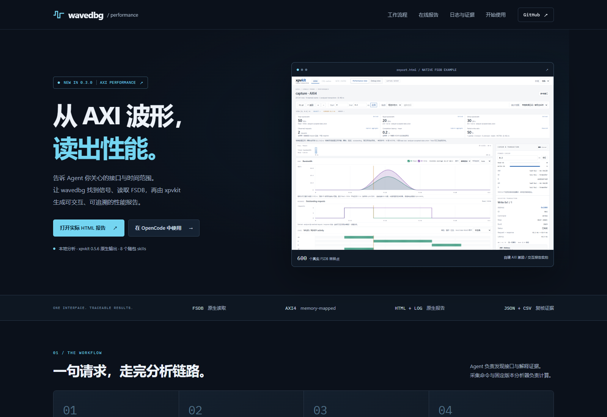
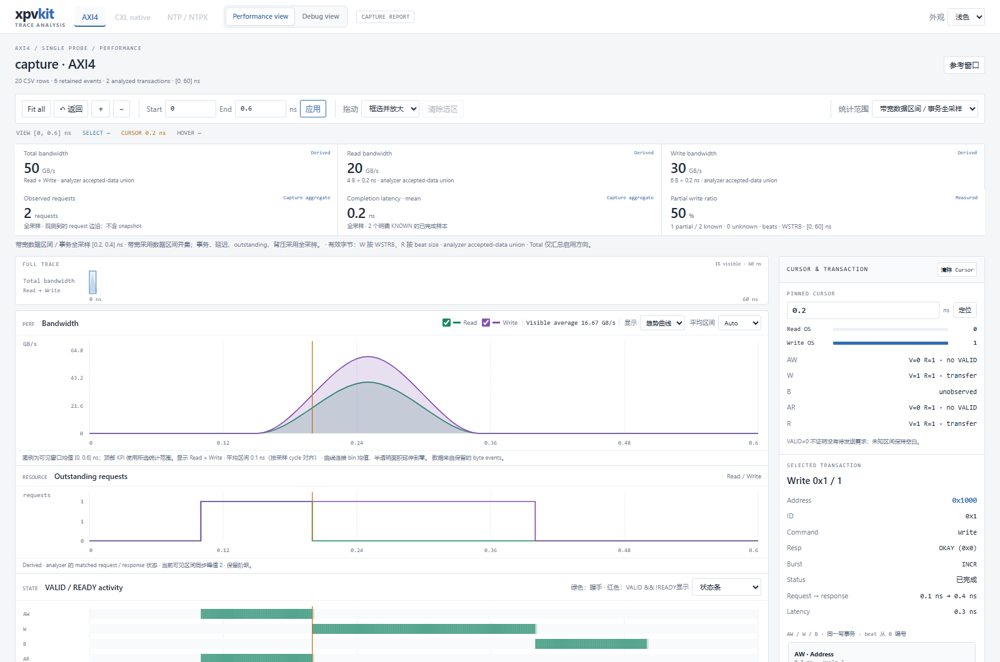

<div align="center">

# TechYan · Engineering Playground

**把工程工具的能力，变成可以直接打开的演示。**

AI 波形调试 · 总线性能分析 · 协议可视化 · 验证与寄存器工具

[**进入项目网站 ↗**](https://techyan.github.io/demo/) · [**体验 wavedbg 最新能力 ↗**](https://techyan.github.io/demo/wavedbg/performance/) · [**选择项目 ↓**](#选择你想了解的项目)

</div>

这里是 TechYan 项目的**公开演示入口**。你可以先了解每个项目解决什么问题，再选择网页体验、实际报告或示例资料。浏览这些内容无需安装工具，也无需访问私有源码仓库。

## 最新推荐：wavedbg · 从 AXI 波形到性能报告

**wavedbg 让 OpenCode 等 AI Agent 查询 FSDB 波形与 KDB 设计信息，沿着信号、连接和源码组织调试证据。** v0.3.0 新增 AXI4 performance skill：指定接口与时间范围，确认真实信号和采样契约后，读取波形并生成 xpvkit 原生 HTML、事务日志和性能汇总。

[](https://techyan.github.io/demo/wavedbg/performance/)

**[进入 wavedbg 新功能展示页 →](https://techyan.github.io/demo/wavedbg/performance/)**

| 你想了解什么 | 可以看到什么 | 直接进入 |
|---|---|---|
| 最新性能分析能力 | OpenCode 使用流程、接口发现、采样、报告与指标口径 | [图文功能页](https://techyan.github.io/demo/wavedbg/performance/) |
| 实际生成的结果 | 可缩放的带宽趋势、outstanding、事务详情，Performance / Debug 双视图 | [打开 HTML report](https://techyan.github.io/demo/wavedbg/performance/data/native/report.html) |
| 每笔传输如何完成 | AW / AR / W / R / B 事件、事务引用、WSTRB 与完成延迟 | [阅读 tracker.log](https://techyan.github.io/demo/wavedbg/performance/#logs) |
| 性能结论与分析依据 | 流量、带宽、延迟、背压、完整性诊断 | [阅读 analyze.log](https://techyan.github.io/demo/wavedbg/performance/?log=analysis#logs) |
| 波形调试的方法 | 握手等待、时钟停摆、credit 回补、首次出现 X 四个交互导览 | [进入波形案例](https://techyan.github.io/demo/wavedbg/) |
| 离线查看与复核 | HTML、日志、CSV、JSON、原始 probe 参考报告和来源记录 | [下载示例 ZIP](https://techyan.github.io/demo/wavedbg/performance/wavedbg-axi-native-demo.zip) |

### 实际报告预览

[](https://techyan.github.io/demo/wavedbg/performance/data/native/report.html)

*点击图片即可操作对应报告。此示例来自自建 AXI4 激励的真实 FSDB：600 个采样点、1 读 / 1 写，使用 xpvkit 0.5.6 生成原生报告。它展示分析流程，不代表用户 DUT 的性能。*

**怎么看懂结果？** 相同的 10 B 传输，按 200 ps 的有效数据窗口计算为 **50 GB/s**；按 60,000 ps 的完整采样窗口计算为 **0.1667 GB/s**。网页并列解释这两个口径，同时提供[原始 xpvkit probe 报告](https://techyan.github.io/demo/wavedbg/performance/data/probe/report.html)与[对照记录](https://techyan.github.io/demo/wavedbg/performance/data/comparison.json)。

真实使用时，可以向 Agent 提出：

```text
使用 wavedbg-axi-performance，分析指定 FSDB 中 tb.dut.m_axi 接口
在 10–20 us 的读写性能。确认信号、时钟、复位与采样精度，
生成 HTML report、tracker.log、analyze.log，并解释不同窗口下的
带宽、读写延迟、outstanding 与背压。
```

v0.3.0 提供 **8 个随包 skills**。本地原生分析需要 Linux、Python 和现场授权的 Verdi 环境；网页可独立浏览，展示已有结果。wavedbg 源码仓库仍为私有，**本页所有演示入口均指向公开内容**。详细流程见[公开使用说明](wavedbg/performance/README.md)；旧版四个波形导览仍保留其 v0.2.1 来源标注。

## 选择你想了解的项目

不确定从哪里开始？需要 **AI 查波形**选 wavedbg，需要 **分析总线性能结果**选 PVKit，需要 **理解报文拆分**选 Bus Protocol Lab。其余入口按用途列在下方。

| 项目 | 解决什么问题 | 展示内容 | 在线入口 |
|---|---|---|---|
| **wavedbg** | 让 AI 根据问题查波形，并从指定 AXI 接口生成性能结论 | v0.3.0 实际 HTML / log；四个波形调试导览 | **[最新能力 ↗](https://techyan.github.io/demo/wavedbg/performance/)** · [波形案例](https://techyan.github.io/demo/wavedbg/) |
| **PVKit** | 分析总线流量、性能瓶颈与事务关联 | 15 个 AXI4 / CXL Native 场景，HTML、真实 TUI、tracker 与 CSV | **[选择场景 ↗](https://techyan.github.io/demo/projects/pvkit/)** |
| **Bus Protocol Lab** | 理解 AXI、PCIe 的字节映射与报文拆分 | AXI→PCIe Packet Studio、AXI Atomic、PCIe TLP Split | **[操作协议工具 ↗](https://techyan.github.io/demo/projects/bus-protocol-lab/)** |
| **PG Builder** | 编辑寄存器操作流程并导出结果 | 可操作的 PG 编辑器，read / write / rmw / poll 示例 | **[打开编辑器 ↗](https://techyan.github.io/demo/projects/pg_gen/)** |
| **UVM Wiki** | 了解验证环境结构并关联源码 | 从脱敏 demo_uvm 生成的 7 种视图、索引与源码浏览 | **[浏览结构 ↗](https://techyan.github.io/demo/projects/uvm_wiki/)** |
| **SVIP** | 阅读协议 VIP 使用指南与验证示例 | AXI4 / APB / JTAG / SPI / Control，13 份指南、17 个自有示例 | **[查看指南 ↗](https://techyan.github.io/demo/projects/svip/)** |
| **xpggen** | 了解终端寄存器操作与多格式导出 | 真实 TUI 截图、合成寄存器、PG 与四种导出格式 | **[查看终端演示 ↗](https://techyan.github.io/demo/projects/xpggen/)** |
| **xDCT** | 比较设计接口变化与兼容性影响 | 两版 top interface 的语义对比、筛选、6 个 breaking change | **[打开接口对比 ↗](https://techyan.github.io/demo/projects/xDCT/)** |

[网站项目索引](https://techyan.github.io/demo/)还支持分类筛选、中文 / 英文搜索、深浅主题和手机浏览。

## 从演示继续追踪证据

每个项目都提供独立说明，标注展示方式、输入来源和结果边界：

[wavedbg 最新性能能力](wavedbg/performance/README.md) · [wavedbg 波形案例](wavedbg/README.md) · [PVKit](pvkit/README.md) · [Bus Protocol Lab](bus-protocol-lab/README.md) · [PG Builder](pg_gen/README.md) · [UVM Wiki](uvm_wiki/README.md) · [SVIP](svip/README.md) · [xpggen](xpggen/README.md) · [xDCT](xDCT/README.md)

浏览器工具可以直接操作；TUI 页面展示真实截图或终端打印；指南不在浏览器运行仿真。公开输入来自合成或脱敏示例，私有源码仓库的可见性不变。来源、处理说明与文件哈希随各项目提供。

---

下面是演示站维护说明；首次访问可以直接从上方选择项目。

## 本地开发与构建

需要 Node.js 24（或满足 `package.json` 的版本）和 Python 3.11+。Python 用于文件与链接检查。

```bash
npm ci
npm run dev
```

```bash
npm test
npm run build
npm run check:site
npm run preview
```

`npm run build` 输出根路径版本，适用于 Cloudflare Pages；`npm run build:github` 输出 `/demo/` 版本，适用于 GitHub Pages。两种构建都会将独立演示文件复制到 `dist/`，保留原有 PVKit URL 和文件内容。`dist/` 与 `node_modules/` 不提交。

浏览器测试使用系统 Edge：先运行 `npm run preview -- --port 4321`，再运行 `npm run test:browser`。其他平台可在 `playwright.config.mjs` 中改用已安装的 Chromium。

## 目录与后续扩展

```text
src/pages/              Astro 导航与项目详情
src/components/         作品卡片、技术示意、图标
src/data/projects.json  项目、分类、演示入口和展示范围
src/styles/             Tailwind 与站点主题
public/                 favicon / Cloudflare headers
pvkit/                  独立演示包；其余七项各占同名目录
wavedbg/                合成案例、原始查询输出与来源；交互页由 Astro 生成
scripts/                站点构建、静态检查、演示重建
tests/                  筛选逻辑与真实浏览器测试
.github/workflows/      GitHub Pages 自动发布
```

增加项目时，在 `src/data/projects.json` 中登记信息，将演示放到独立顶级目录，并加入 `scripts/build-site.mjs` 的复制清单。示例重建脚本只负责对应项目，避免覆盖 Astro 导航与总 README。

各新项目的 `provenance.json` 记录固定源提交、原文件哈希和公开范围；PVKit 的 `manifest.json` 与 `SHA256SUMS` 记录 release 输入和全部静态文件校验。模板、字体与第三方库说明见 [THIRD_PARTY_NOTICES.md](THIRD_PARTY_NOTICES.md)。

wavedbg 数据可以在不安装原生环境的情况下独立核对：`python scripts/build_wavedbg_examples.py --check`。此检查也在 GitHub Pages 发布前执行。
