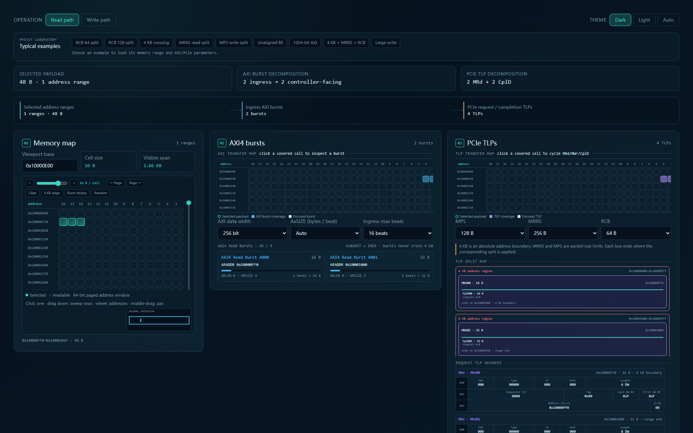

# Bus Protocol Lab demo package

[Open the local lab](index.html) · [Project overview](../projects/bus-protocol-lab/) · [Project hub](../)

Three complete browser tools are included. Open an HTML file directly or serve this folder as static files; no installation, API key, CDN, or build is required.

| Tool | Entry | Try first |
| --- | --- | --- |
| AXI to PCIe Packet Studio | [axi-pcie-packet-studio.html](axi-pcie-packet-studio.html) | Choose **4 KB + MRRS + RCB**, then click a burst or packet to trace its payload. Nine named examples cover reads, writes, alignment, and payload limits. |
| PCIe TLP Split Demo | [pcie-tlp-split-demo.html](pcie-tlp-split-demo.html) | Choose **Cross 4KB**, compare MRd and CplD boundaries, then change MRRS, MPS, or RCB. Three presets are included. |
| AXI Atomic Demo | [axi4-atomic-format-table.html](axi4-atomic-format-table.html) | Click **Auto Demo**, then select memory or byte-lane cells. Three operand widths, two operation modes, and four bus widths provide 24 parameter combinations. |

The tools explain selected protocol behaviors; they are visual learning/debug aids, not a protocol compliance checker. The atomic view includes the source tool's internal request-data model as well as its AXI-facing placement. Packet Studio limits very large models and marks truncated views in its status.

Source: [TechYan/bus-protocol-lab](https://github.com/TechYan/bus-protocol-lab), pinned in [provenance.json](provenance.json). The only HTML changes are relative return navigation and its scoped styling. The original index remains inside this package and does not replace the hub. [manifest.json](manifest.json) lists all entries and presets.
